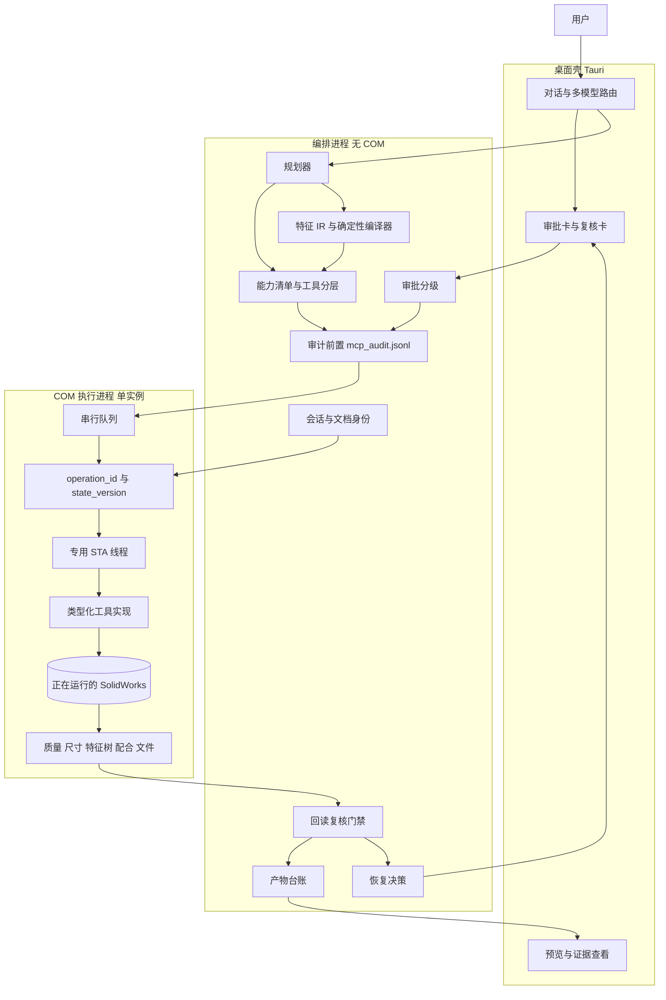

# 2. MoSolid 目标架构

MoSolid 是桌面产品，不是又一个只暴露几十个工具的 MCP 实验。模型可以规划，执行进程只接受类型化工具、已落盘的审计记录和与当前文档一致的状态版本。工具函数返回成功，只表示调用没有抛异常；任务完成还要过回读和复核。

底座是本仓库已有的 Skill、MCP、Execution Core、能力清单和 CAD Studio。COM 线程模型、幂等版本和特征图是新增的执行契约。SolidPilot 只提供设计参照，实现另写。

## 2.1 模块图

进程边界是硬的：

- 桌面壳不加载 SolidWorks RCW，也不保存可重放的 COM 指针。
- 编排进程负责模型、审批、审计、IR、复核和台账。它通过本地回环的长度前缀 JSON 调用执行进程，不把 MCP 当作内部总线。
- COM 执行进程是唯一允许 `CoInitialize` 并创建 SolidWorks RCW 的进程。一台交互式 SolidWorks 对应一个执行进程。
- 开放格式（STEP/STL 的无 CAD 写入）继续走本仓库的无头后端，不进入这个 STA，也不许用空文件或改扩展名冒充原生零件。

## 2.2 MCP 服务

对外仍是 MCP，因为现有 Codex、Claude、Cursor 入口要保留。MCP 进程与 COM 进程分离。

- 工具清单以本仓库 `capabilities.yaml` 为唯一等级真源。MCP 的 `name`、输入 schema 和清单 `id` 用契约测试锁住，避免 SolidPilot 文档数字和 Millwright README 那种漂移。
- 发现模式继续用本仓库已有的 `sw_search_tools` / `sw_describe_tool` / `sw_call_tool` 网关。隐藏工具不能靠客户端直接点名绕过网关。
- 模型看不到执行进程的内部 REST。一个 MCP 工具对应一次已审计的操作，或一次只读查询。
- 传输可以是 stdio。HTTP 若开启，只绑本地回环，并沿用现有批准账本；不把 SolidWorks 会话暴露到局域网。

P0 到 P4 的公共工具是白名单，不是“把 154 个名字并进来”。并集会把未验证工具和任意代码工具一起放进上下文。

## 2.3 COM 执行层与 STA

执行进程启动时创建一条后台线程，`CoInitialize`（STA）之后才允许连接 SolidWorks。之后所有 COM 调用，包括附着、新建、读质量属性、关闭文档，都变成提交到该线程的闭包。其他线程只持有请求 id 和 JSON。

行为规格（实现时新写，不移植 SolidPilot 的 `StaExecutor.cs` 或各 Python `ComExecutor`）：

| 规则 | 原因 |
|---|---|
| 一个执行进程一条 STA 线程，队列一次跑一个闭包 | SolidWorks RCW 有线程亲和性。MTA 上轻量调用有时能返回，钣金和圆角会空返回或死锁。这是 SolidPilot 注释里的现象，hjbaard、python、Millwright 的专用线程是同一约束的独立实现 |
| 只有一个 `SLDWORKS.exe` 时用 `GetActiveObject` 附着已经打开且许可就绪的实例。多个实例按本节后面的表处理 | 不调用 `Dispatch("SldWorks.Application")` 去创建第二个实例，也不在多实例时碰运气连接 |
| 等待超时作用在编排进程对队列的等待上，默认 120 秒。超时是硬性通过条件 | 模态对话框会让已经进入 STA 的调用一直不返回，执行进程因此永久占住这条线程。超时后按下面的步骤处理，不能只打一条日志 |
| STA 线程不注册事件 sink，也不跑消息泵 | hjbaard 的实现说明：非泵送 STA 上注册 sink 会丢事件。需要 PropertyManagerPage、TaskPane、长期事件时，走本仓库已有的 C# 进程内 Add-in 后端，而不是把 sink 塞进这条线程 |
| 重入：若闭包内部再次提交 COM，检测到已在 STA 上则直接执行 | 避免队列自己等自己。Millwright 的 executor 有这个分支，行为上需要，代码另写 |
| 执行进程崩溃或被超时流程结束后，编排进程丢弃全部 RCW 假设 | 内存中的 `state_version` 标为未知。未知版本不允许发变更操作 |

STA 超时的硬性通过条件：

1. 编排进程立即停止接收变更。尚未开始的排队变更丢弃，并写 `phase=cancelled`，原因 `sta_timeout`。
2. 结束执行进程，让卡在 COM 里的线程随进程消失。不结束 `SLDWORKS.exe`。
3. 启动新的执行进程并重新附着。新会话的模式是 `query_only`。
4. `query_only` 期间变更接口返回 `EXECUTOR_QUERY_ONLY`。查询只用来读取特征树、尺寸、质量属性和活动文档身份，组成指纹。
5. 指纹与超时前最后一条 `result=ok` 一致，或与本步 intent 中的调用前指纹一致，才按 2.7 的审计状态决定能否用同一 `operation_id` 重试。核对不一致就保持 `query_only`，运行记 `BLOCKED`，直到人把当前查询结果确认为新基线。
6. 不向对话框发送 `WM_CLOSE`。`dialog_dismiss_count` 保持 0。

多个 `SLDWORKS.exe` 时的附着规则：

| 进程数 | 行为 |
|---|---|
| 0 | 不启动 SolidWorks。返回 `environment_missing` |
| 1 | `GetActiveObject` 附着，并把该进程的 pid 写入会话 |
| 大于 1 | 不调用 `GetActiveObject`，因为它不指定实例。返回 `AMBIGUOUS_INSTANCE`，列出每个 pid、可执行路径和主窗口标题。会话只有在调用方传入其中的一个 `target_pid` 后才继续。若运行时无法把 COM 指针绑到这个 pid，返回 `INSTANCE_NOT_BINDABLE`，由操作者关掉其余实例。不连接“列表里的第一个”，也不连接 `GetActiveObject` 碰巧返回的那一个 |

C# PIA 与 Python `pywin32` 都可能成为这条线程上的实现。P1 选一种，用契约测试锁请求/响应，不在同一步里混用两套 RCW。本仓库能力路由里“封送失败则换 comtypes 或 C#”的规则保留为显式后端切换，每次切换都重新回读，不把前一个后端的成功当成结果。

已知会挡住无人值守运行的首选项，在会话开始时记录原值、改为自动化值、会话结束时恢复：

- `swInputDimValOnCreate`：创建尺寸时弹出输入框。SolidPilot 与 hjbaard 都临时关掉它。
- 默认模板：缺少模板会弹出新建对话框。本仓库已有“始终使用默认模板”的设置。模板不是 Y-up 时，按 hjbaard 的检查拒绝建模并说明如何设置 `.prtdot`，不在对话框里替用户点选。

`solidworks_recover` 继续只做诊断。自动向对话框发 `WM_CLOSE` 保持默认关闭。关闭未知对话框会确认掉“是否保存”“文件已存在”一类问题。

## 2.4 工具清单分层

工具按副作用分级。等级写在清单里，MCP schema 和审批共用。新增工具先改清单，再注册。

| 层 | 例子 | 副作用 | 默认审批 | 完成条件 |
|---|---|---|---|---|
| Q 查询 | 健康检查、质量属性、包围盒、特征树、尺寸列表、配合列表、文档身份、选择集 | 不改模型、不写用户文件 | 不需要 | 返回结构化读数；读失败是失败，不用空对象冒充 |
| M 建模 | 新零件、草图、完全定义、拉伸、切除、孔、圆角、倒角、改驱动尺寸、重建 | 改本轮新建文档，或改已打开且用户点名的零件 | R1；改已有用户文件升为 R2 | 重建无错误；回读尺寸、体积、质量、特征树与预期一致 |
| A 装配 | 新装配、插入组件、配合、固定/浮动、干涉 | 改装配 | R1 / R2 同上 | 回读组件名、变换、配合类型与数量；干涉结果与预期一致 |
| D 工程图 | 新图纸、视图、模型项尺寸、中心标记、保存 SLDDRW | 改图纸 | R1 / R2 | 保存后重开；PDF 文本或图纸对象能对上关键尺寸。目视项保持 `review_required` |
| X 导出 | 保存、STEP、PDF、PNG、Pack and Go | 写磁盘 | R3，覆盖已有文件必须点名 | 产物台账：路径、大小、SHA-256、`producedThisRun`。旧文件不得交付 |
| S 会话 | 附着、激活已打开文档、关闭本轮创建的文档 | 改变活动文档 | 激活用户原有文档要带文档身份；关闭用户原有文档是 R3 | 活动文档标题与身份一致 |
| Z 不可逆 / 逃逸 | 删除特征、删除文件、宏执行、shell、任意 Python | 不可由特征树回滚完全撤销 | P0–P4 不注册。以后每次 R3，且没有 `auto` | 不在本阶段验收 |

P4 验收路径只使用 Q/M/A/D/X/S。层与层之间不共享“成功”定义。例如导出成功不证明配合正确。

单位在工具边界上用毫米和度，执行层进入 SolidWorks 前换成米和弧度，回读再换回毫米。内部单位泄漏到模型提示词里，是 SolidPilot 和 Millwright 都踩过的成本；MoSolid 在 schema 里写死单位，契约测试拒绝未标注单位的长度字段。

## 2.5 特征 IR

特征 IR 是规划器和编译器之间的 CAD 中性图，不是 MCP 工具清单，也不是本仓库的 `design_plan.json`。`design_plan` 继续负责自然语言里缺参数时的人工可读计划；它不能直接驱动 COM。

目标数据流：

1. 规划器输出一张图：基准、草图、特征、尺寸名、装配实例、配合。节点引用的是上游节点的命名输出，不是屏幕坐标。
2. 结构校验只检查类型、必填参数、单位和节点引用是否存在。它看不到 B-rep，不能宣称面存在。
3. 确定性编译器把图降成有序工具调用。同一张图加同一个起始 `state_version`，得到同一调用序列。编译器里没有第二个模型。
4. 引用解析在编译或执行时做：尺寸走 `width@Sketch1` 这类名字；面和边走“本次重建有效”的索引。`state_version` 一变，索引作废，必须重新查询。
5. 执行层不知道 IR。它只接受已经审计过的工具调用。

分阶段约束：

- P1–P4 的验收用例用类型化工具直接跑通，不把 IR 当关键路径。这样几何门禁先成立。
- P6 才让规划器默认走 IR。在持久命名还不能跨“改一个上游尺寸”存活之前，不删除底层工具，也不宣称一次模型调用就能完成产品。SolidPilot 自己把“前向门已经能跑”和“底层工具可以退役”写成两件事。
- IR schema 由我们按验收零件反推，不复制 `feature-graph.schema.json`。复制该文件会把 AGPL 材料带进仓库。

几何锚点可以复现“从零重建同一零件”，不能在用户改了板厚之后仍指向原来的孔边。改尺寸走尺寸名；选边在索引失效后重新 `list_edges`。这是 P6 的验收，不是 P2 的借口。

## 2.6 回读验证

每个变更工具的响应都带测量值，不带“看起来成功”。测量来自重建之后的第二次 API 读，不来自请求参数的回声。

| 对象 | 回读 |
|---|---|
| 零件尺寸 | 驱动尺寸的系统值换算成毫米，与请求比较。改尺寸若回读不等于目标，写回旧值并返回失败。阈值沿用 hjbaard 量级：系统值绝对差小于 1e-9 视为写入成功，产品公差另定 |
| 体积 / 质量 / 表面积 / 质心 | `CreateMassProperty` 或等价接口。材料未设置时质量是未知，不能用默认密度填成已验证 |
| 特征树 | 名称、类型、抑制状态。期望新增的特征必须出现，期望保留的特征不得消失 |
| 草图 | 欠定义草图使该步失败。不用批量 Fix 代替设计尺寸 |
| 装配 | 实例名、变换、配合类型、对齐、距离或角度的尺寸值 |
| 干涉 | 干涉体积或“无干涉”的显式布尔。未跑检测不得写成无干涉 |
| 工程图 | 保存并重开后的视图名、关键尺寸文本。PDF 只证明导出的文字，不证明 GD&T 语义 |
| 文件 | 路径存在、非空、SHA-256、mtime 落在本轮。STEP 能被无头读回包围盒时再记一笔几何旁证，旁证不等于原生特征树正确 |

聚合规则沿用 Execution Core：`BLOCKED` 高于 `FAIL`，高于 `WARN`，高于 `PASS`。必选检查失败时，顶层不得为 PASS。需要复核的能力在人工复核完成前保持 `review_required`。

体积方向检查（拉伸体积增加、切除体积减少）只作为快速断言。安装板验收使用解析体积和容差，不用“体积变了”代替“孔在正确位置”。

## 2.7 强制审计

关键写操作指会改变 SolidWorks 文档或用户磁盘的 M/A/D/X/S 中的变更，以及将来的 Z。

顺序固定：

1. 编排进程生成 `operation_id`，计算参数的规范摘要和脱敏副本。
2. 向 `mcp_audit.jsonl` 追加一条 `phase=intent` 记录，`flush` 且 `fsync`。
3. 只有这一步成功，才把调用送入 COM 队列。
4. COM 返回后追加 `phase=result`，包含回读摘要、`state_version` 和错误码。结果记录失败时，运行标为 `BLOCKED`：模型可能已经改了 CAD，审计不完整，禁止自动重试。
5. 审批拒绝追加 `phase=denied`，不调用 COM。

同一 `operation_id` 的审计状态决定能不能再执行：

| 已落盘的记录 | 再次遇到这个 id |
|---|---|
| 只有 `intent`，没有 `result` | 允许用同一 id 重试这一次逻辑操作。重试前先处于 `query_only`，把当前指纹和 intent 里的调用前指纹比较。指纹未变，说明 COM 没有提交，可以重试。指纹已变，说明崩溃点可能在 COM 已经生效之后，不重试，记 `BLOCKED`，错误码 `COMMIT_UNCERTAIN` |
| `result` 且状态为 ok | 返回 `DUPLICATE`，附带已保存的 result，不再调用 COM |
| `result` 为 fail，或记录为 `BLOCKED` | 不返回 `DUPLICATE`。按错误码处理：`invalid_argument` 不重试；`verification_failed` 不自动再写；`AUDIT_UNAVAILABLE` 在原因消失前不重试；`COMMIT_UNCERTAIN` 与 `sta_timeout` 保持 `query_only`，直到人确认基线 |

`intent` 记录至少包含：时间、`run_id`、`session_id`、`operation_id`、工具名、分层、审批 id（R0/R1 可为空）、文档身份、期望 `state_version`、调用前指纹、参数摘要。秘密、令牌、完整系统提示不入库。

对外可观测的同步点，用来证明 intent 早于特征创建：

- fsync 成功后、COM 入队前，编排进程写出收据 `runtime/audit-ready/<operation_id>.json`，内容是审计文件路径、字节偏移、`audit_seq` 和收据时间，并再次 fsync。
- 生产路径在收据成功后立即入队。
- 验收构建设置 `MOSOLID_HOLD_BEFORE_COM=1` 时，收据写出后暂停入队，直到测试进程删掉 `runtime/hold/<operation_id>`。暂停期间查询仍可执行。
- 测试在暂停点读取审计文件，断言该 `operation_id` 的 `intent` 行位于收据偏移之内，再用查询断言特征树还没有新特征。然后释放暂停。特征出现的时间必须晚于收据文件的 mtime。

现有 Trace 继续当调试事件流，写失败不影响查询。它不替代 `mcp_audit.jsonl`。两套日志的职责分开：Trace 是过程，审计是关键写操作的前置条件，台账是交付文件事实。

审计文件按会话滚动，放在本机固定磁盘的用户目录，权限限当前用户。

`AUDIT_UNAVAILABLE` 只表示审计没有成为耐久记录，不表示“fsync 花得久”：

| 情况 | 结果 |
|---|---|
| `FlushFileBuffers`（或等价 fsync）返回成功 | 继续执行。耗时写入 intent 的 `audit_fsync_ms`。本地 NTFS 上超过 2 秒只记指标，不失败 |
| 调用被杀毒软件或过滤器拖住，但最终成功 | 同上。验收注入 3 秒延迟且返回成功时，不得出现 `AUDIT_UNAVAILABLE`，且 `audit_fsync_ms` 不小于 3000 |
| 共享冲突（例如杀毒软件短暂锁文件） | 在 COM 之前最多重试 3 次，间隔 200 ms、500 ms、1000 ms。任何一次成功即继续 |
| 磁盘满、路径不可写、fsync 返回 IO 错误，且重试仍失败 | `AUDIT_UNAVAILABLE`，不调用 COM |
| 审计路径在网络盘、UNC 或 `GetDriveType` 为可移动/远程介质 | 等待上限 30 秒，界面提示“审计写入变慢”。上限内成功则继续。本地固定磁盘的等待上限是 5 秒。两种上限都只在调用返回错误或超过上限时才失败 |

不使用几十毫秒的 fsync 超时，避免把杀毒扫描或网络盘延迟误报成审计失败。

## 2.8 审批分级

| 级 | 何时 | 行为 |
|---|---|---|
| R0 | Q 查询、健康检查、只读预览 | 直接执行，仍写 Trace；不写 intent 审计 |
| R1 | 本轮新建的零件、装配、图纸上的建模与出图 | 会话开始时用户确认“允许本轮新建文档”。此后 R1 不再逐次打断。审计照写 |
| R2 | 修改用户事先已打开或点名的已有文件；删除/抑制特征；改已有配合 | 每步确认卡，显示工具名、文档、参数摘要。拒绝则 `denied` |
| R3 | 覆盖保存、导出到已存在路径、关闭或保存用户原有文档、Pack and Go、宏、shell、外网、跨工作区 | 每步确认。不存在跳过确认的模式 |
| R4 | 交付复核 | 沿用 CAD Studio：证据不足或能力等级不是可无人值守时，人点通过或驳回。驳回不改写几何证据 |

确认卡显示人可读摘要，按钮只有允许和拒绝。模型工具参数里的 `approved=true` 无效，沿用 `mcp-server/approval.py` 已经写明的规则。

批准记录绑定工具名、参数摘要、文档身份和调用方，一次性，带期限。参数变了，旧批准作废。CAD Studio 里“批准原因变化则重新拦截”的规则推广到这里。

Millwright 的四档交互可以参考界面，默认档是上面的 R0–R4，不提供 `auto`。无人值守只允许出现在显式的回归脚本里，脚本使用独立的空 SolidWorks 配置，并且仍写审计。

## 2.9 错误、弹窗、断线与文档切换

恢复决策沿用 `scripts/core/recovery.py`：只分类，不自动重放变更。不确定则阻塞或失败。`DEFAULT_MAX_RETRIES` 保持 2，且只适用于读取和附着，不适用于已经可能写入的变更。

| 情况 | 判定 | 动作 |
|---|---|---|
| 参数缺单位、孔超出板、半径为负 | `invalid_argument` | 不调用 COM。审计不写 intent，因为没有写操作 |
| 未安装、未运行、无许可 | `environment_missing` | 停止原生路径。只有任务允许开放格式时才走无头后端 |
| 模态对话框或 STA 超时 | `user_action_required` | 执行 2.3 的硬性步骤：停止接收变更、重启执行进程、重新附着、`query_only` 直到指纹核对通过。报告窗口标题（若枚举成功）。不发送 `WM_CLOSE` |
| `state_version` 不一致 | `policy_blocked` 类的状态拒绝 | 不执行。强制重新查询。常见原因是用户在 GUI 里改了模型，或断线重连把本地版本复位 |
| 活动文档在调用前被用户切换 | 文档身份不匹配 | 变更操作失败。身份沿用 `mcp-server/document_identity.py` 的绑定，标题相同不够 |
| `RPC_E_DISCONNECTED`、执行进程崩溃或进程消失 | `backend_unavailable` | 停止接收变更，重启执行进程，不新开 SolidWorks。重新附着后只允许查询。只有 intent 没有 result 时按 2.7 决定能否用同一 id 重试；已有 `result=ok` 则返回 `DUPLICATE`。指纹对不上最后一条可靠 result 时保持 `BLOCKED` |
| 重建错误、回读超差 | `verification_failed` | 不进入完成。改尺寸的回滚只在“写完立刻回读失败”这一条路径上做，并且回滚本身也要审计 |
| intent 审计失败 | `AUDIT_UNAVAILABLE` | 不调用 COM |
| result 审计失败 | `BLOCKED` | 不自动重试 |
| 能力不在清单 | `capability_gap` | 把缺口交还规划器。执行进程不联网写新工具 |

文档切换专门做成测试，因为“当前活动文档”是隐式全局变量。变更工具的参数里带本轮绑定的文档身份；执行前 STA 上再读一次活动文档，不一致就失败。查询工具可以带 `activate=false` 读指定已打开文档，但必须在响应里返回实际读到的标题。

用户已经打开的 SolidWorks 在失败时不被任务杀掉，也不被任务关闭其事先打开的文件。这与本仓库 Golden 验收里“已有实例则 BLOCKED，不杀进程”一致。回归脚本若要求空进程，由脚本在启动前检查，而不是由库函数清理用户桌面。

## 2.10 与现有 Execution Core 的关系

Execution Core 继续是编排进程里的可靠性层：状态、能力门面、复核适配、恢复决策、Trace。P1 在它前面加审计门，在它后面保持现有复核。

不把 Core 改成第四个用户入口，也不把审批、租约和台账重写进 Core。`docs/architecture/execution-core.md` 已写明这些不是 Core 的职责。MoSolid 的新增代码落在 COM 执行进程、审计门和桌面审批卡，Core 只增加可选的审计结果字段。
