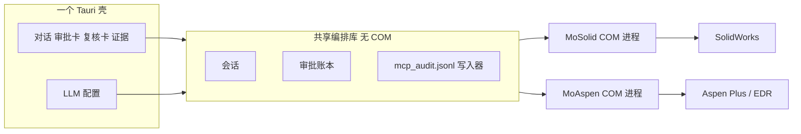

# 4. 与 MoAspen 的共享，以及仓库怎么放

## 4.1 读源码的结果

任务要求 MoSolid 沿用 MoAspen 的架构，并尽量复用其桌面壳、LLM 配置、会话和审批审计。

审查确认 `Appwomb/MoAspen` 的提交 `57f9a2e` 是 Tauri 项目，仓库里没有 LICENSE 文件。在该仓库放入 LICENSE 并且完成许可证评审之前，禁止复制、改写或 submodule 其中任何文件。没有许可证时按保留所有权利对待。

本轮执行环境的 GitHub 安装令牌只覆盖 `solidworks-automation-skill`，打不开 `57f9a2e` 的文件树，所以下面的差表不填写未读到的路径、依赖版本和审计字段。CAD Studio 一列来自本仓库 `9ba848e` 的已读代码。

## 4.1.1 桌面壳差表

| 项 | CAD Studio（本仓库 `9ba848e`，已读） | MoAspen（`57f9a2e`） |
|---|---|---|
| 壳 | Tauri 2。`apps/workbench-ui`，产品名 CAD Studio，标识 `com.wzyn.cadstudio`，版本 2.0.1，窗口 1440×980，NSIS 安装包 | Tauri。窗口、标识、前端框架和 Tauri 版本未从文件树读到 |
| 前端 | React 19、Vite 7、TypeScript 5.9 | 未读到 |
| 许可证 | 仓库根 MIT | 没有 LICENSE。禁止复制 |
| 模型配置 | `apps/desktop/cad_workbench/agent_providers.py`：Codex、Claude Code、Gemini CLI、OpenCode。界面说明不展示密钥 | 未读到字段名。对齐前不假设与 CAD Studio 同名 |
| 会话 | 桌面 SQLite 索引项目、对话、消息和任务（`apps/workbench-ui/src/types.ts` 的 `storage: "sqlite"`） | 未读到 |
| 审批 | 任务状态含 `approval_required`。Policy Gate 在 worker 里拦截，原因变化会重新拦截 | 未读到是否在 COM 之前阻断 |
| 审计 | 队列事件 JSONL 与产物台账。关键写操作的 `mcp_audit.jsonl` 仍是 MoSolid 要新增的门，不是 CAD Studio 今天的 Trace | 未读到是否已有 `mcp_audit.jsonl`，也未读到写失败是否阻断 |
| COM | 本仓库脚本在调用线程连接 SolidWorks。MoSolid 的 STA 执行进程是新增的 | Aspen COM 进程必须与 SolidWorks 执行进程分开。具体附着方式未读到 |

共享仍是一个 Tauri 壳加两个域执行进程。在能打开 `57f9a2e` 的文件树之前，P5 只接 CAD Studio，不抽取共享库，也不把 MoAspen 源码拷进本仓库。

## 4.2 任务说明里必须对齐的形状

这些是产品约束。MoAspen 的文件级字段等能打开 `57f9a2e` 之后再补，现在不臆造：

| 约束 | MoSolid 中的落点 |
|---|---|
| 自然语言、多模型 | 桌面壳里的模型路由。本仓库已有 Codex、Claude Code、Gemini CLI、OpenCode 桥 |
| 工具层 | 第 2 篇的分层白名单，不把模型直接接到 COM |
| 审批 | R0–R4。拒绝则不调用 COM |
| Windows COM | 独立执行进程，专用 STA |
| 回读验证 | 尺寸、体积、质量、特征树、配合、导出文件。失败则运行不完成 |
| 会话 | 一次用户任务一个 `session_id`，下面有 run、文档身份、检查点文件 |
| `mcp_audit.jsonl` | 关键写操作的前置审计。文件名按任务说明固定。MoAspen 在 `57f9a2e` 是否已有该文件，本轮未读到 |
| Tauri 桌面 | 壳用 Tauri，不用再做一个 Electron 产品 |

Aspen 与 SolidWorks 不能共用一个 COM 公寓或一条 STA 线程。两者都是有窗口、有模态对话框的 Windows 桌面程序，RCW 不能跨进程传递。共享的是壳和编排里的非 COM 模块。

## 4.3 共享方案

推荐 **一个 Tauri 壳，两个域执行进程，一套编排库**。不推荐把 MoAspen 和 MoSolid 合成一个进程，也不推荐长期维持两套桌面。

共享库里放：

- LLM 端点、协议（Anthropic 兼容 / OpenAI 兼容）、模型名、超时。密钥留在操作系统凭据或环境变量，不进仓库、不进审计、不进聊天导出。
- 会话目录布局：`session_id`、消息索引、run 状态。SQLite 可以保存索引；审计本身仍是追加式 JSONL，避免只存在数据库里而被事务回滚掉“已经执行”的事实。
- 审批卡的数据：等级、摘要、允许、拒绝、期限、参数摘要。
- `mcp_audit.jsonl` 的追加、fsync 和“intent 失败则调用方不得执行”的 API。Aspen 写操作与 SolidWorks 写操作走同一个函数。
- 错误码里与域无关的部分：`AUDIT_UNAVAILABLE`、`APPROVAL_DENIED`、`APPROVAL_STALE`。

不共享：

- SolidWorks 与 Aspen 的工具实现、单位、文档身份和回读字段。
- STA 线程、RCW、对话框枚举。
- 能力清单。SolidWorks 继续用 `capabilities.yaml`。Aspen 用它自己的清单。两份清单可以同一种 schema，但是两个文件。

CAD Studio 是已读到的 Tauri 壳。MoAspen 在 `57f9a2e` 也是 Tauri。合并成一个壳之前，要在能打开文件树时选定保留哪套窗口生命周期。在此之前，P5 只在 CAD Studio 上接 MoSolid 的审批卡和审计，不改 MoAspen，也不复制它的代码。

不把 Millwright 的 Electron 壳当成共享壳。任务指定 Tauri，且本仓库的桌面已经是 Tauri。Electron 只会变成第三个壳。

## 4.4 仓库组织

推荐：**产品仓库新建 `Appwomb/MoSolid`，执行底座继续用本 fork，不把本 fork 改名，也不把 AGPL 项目并进来。**

| 方案 | 结果 | 取舍 |
|---|---|---|
| A. 把本 fork 直接改名为 MoSolid，在这里长桌面和 Aspen 共享代码 | 历史和 Golden 都在 | 这个仓库同时是公开 MIT 的 SolidWorks Skill。放进私有 MoAspen 壳的耦合、以及尚未选定的产品许可证，会把公开技能和私有产品绑死 |
| B. 新建 `Appwomb/MoSolid`，以 git 子模块或固定 SHA 依赖本仓库 | 公开技能继续按 MIT 发布；产品层放壳的集成、审计门和验收 | 多一个仓库。子模块 SHA 必须钉死，避免“最新 main”悄悄改变已验收行为 |
| C. 把所有项目的代码拷进一个新仓库 | 看起来统一 | 立刻碰到 AGPL、python 版权人冲突，以及本仓库已经存在的实现被分叉成两份 |

采用 B，具体规则：

1. `Appwomb/solidworks-automation-skill` 保持公开 MIT 技能与 CAD 执行核心。MoSolid 的 P1–P4 修复优先提交到这里，用子模块 SHA 升级到产品仓库。这样真机回归还在已有 Golden 旁边。
2. `Appwomb/MoSolid` 私有或按老板选定的许可证创建。它包含产品清单、审计门适配、桌面集成和发布流水线。它不复制 SolidPilot。
3. 共享编排库先放在 `Appwomb/MoSolid` 的 `shared/` 目录，等 MoAspen 可读并且两边字段对齐后，再抽成第三个私有仓库 `Appwomb/mo-desktop-kit`。现在抽库会抽出一个 MoAspen 对不上的接口。
4. MoAspen 仓库保持不动。本次不提交、不推送、不改其设置。
5. 其余 fork（SolidPilot、TS、alisamsam、python、hjbaard、Millwright）保持只读参考。不把它们并进 MoSolid 的默认分支。

本设计 PR 做在当前 fork 的 `mosolid-design` 上，是因为任务要求交付物落在本仓库的 `docs/mosolid/`。这不表示产品代码以后也只能提交到这里。P1 若改执行核心，仍在本仓库；P5 的壳集成若需要新仓库，到那时再创建 `Appwomb/MoSolid`。在老板确认 B 之前，不创建新仓库。

## 4.5 读到 MoAspen 之后要补的核对

取得读权限后，先做一份差表，再写共享代码：

| 核对项 | 对齐标准 |
|---|---|
| 桌面技术 | `57f9a2e` 已确认是 Tauri。窗口、sidecar 启动和升级方式仍待读文件后填写，再决定保留 CAD Studio 还是迁到 MoAspen 壳 |
| LLM 配置字段 | 协议、base URL、模型、超时、密钥存放。MoSolid 适配已有 `agent_providers.py`，不平行再发明一套名字 |
| 会话 | 是否已有 SQLite。消息、run、检查点分别在哪 |
| 审批 | 是否在工具执行前阻断。若 MoAspen 已是阻断式，MoSolid 的 R0–R4 映射到它的等级，不另做第二套按钮 |
| `mcp_audit.jsonl` | 真实字段、是否 fsync、写失败时 Aspen 命令是否仍执行。若 MoAspen 今日是旁路日志，要老板决定是加严 Aspen，还是只加严 MoSolid |
| 回读 | Aspen 回读的是变量和报表数值。共享库只共享“回读失败则不完成”的接口，不共享字段 |
| 许可证文件 | `57f9a2e` 没有 LICENSE。出现 LICENSE 之前不复制。有了 LICENSE 之后以该文件为准再评审 |

差表写进后续 PR 的 `docs/mosolid/`，替换本节的 E0 状态。在差表合并之前，P5 不开始抽共享库。
